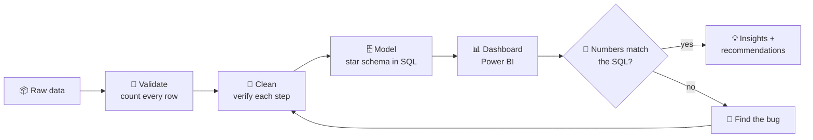

 

 

**[⚡ TL;DR](#-recruiter-tldr)** · **[👤 About](#-about)** · **[🧭 Approach](#-my-approach)** · **[🏆 Projects](#-featured-projects)** · **[🐞 Bugs I Caught](#-bugs-i-caught-and-fixed)** · **[🗺️ Roadmap](#️-roadmap)** · **[🤝 Connect](#-lets-connect)**

---

## ⚡ Recruiter TL;DR

> [!TIP]
> I'm a Data Analyst (Excel · SQL Server · Power BI · DAX · Python) who builds every project **end to end** — raw CSV → validated, cleaned data → star schema → analysis → dashboard → business recommendations — and **checks every number against a second source.**

| 🎯 What I deliver | 📊 Proof (from my projects) |
|---|---|
| Customer segmentation that finds the money | **23% of customers = 65.84% of revenue** across 541K transactions |
| Diagnosis, not just dashboards | Found **why** profit fell while sales grew: **$322K in discounts > $286K total profit** |
| Workforce insight that points to action | **33.4% attrition**, concentrated in Production (~40%); referral hires leave at **16%** vs **61%** for Google Search hires |
| Data I can defend | Row counts verified at **every** cleaning step; SQL results used to check every DAX measure |

---

## 👤 About

| | |
|---|---|
| 🎓 **Education** | B.E. Computer Science Engineering (VTU) |
| 🏅 **Certified** | Google Data Analytics Professional Certificate (Dec 2025) |
| 📍 **Based in** | Belagavi, India |
| 🎯 **Targeting** | Data Analyst · Junior BI Analyst · Business Analyst |
| 🐍 **Learning** | Python (pandas) for advanced analytics |
| 🧠 **Working style** | Count first. Clean second. Cross-check always. Document the bugs. |

---

## 🛠️ Tech Stack

  <b>🗄️ Databases</b> 
  
  
   
  
  
  
  
  
  

  <b>📊 Analytics & BI Tools</b> 
  
  
   
  
  
  
  
  
  

  <b>📗 Spreadsheets</b> 
  
  
   
  
  
  
  
  
  

  <b>🧰 Tools & Learning</b> 
  
  
  
   
  
  

| | |
|---|---|
| 🧪 **Methods** | RFM segmentation · Pareto · root-cause analysis · attrition analysis · profitability analysis |
| 📁 **Proven in** | HR Analytics · Customer Segmentation · Superstore Sales Analysis |

---

## 🧭 My Approach

For the two earlier projects I went further and **rebuilt each one in three tools** (Excel, Power BI, SQL Server). When independent pipelines land on the same answer, the result is trustworthy.

---

## 🏆 Featured Projects

| # | Project | Tools | Status |
|:-:|---|---|:-:|
| 1 | [**HR Analytics — Employee Attrition, Workforce & Compensation**](#1️⃣-hr-analytics--employee-attrition-workforce--compensation) | SQL Server · Power BI | ✅ Completed |
| 2 | [**Customer Segmentation & Revenue Intelligence**](#2️⃣-customer-segmentation--revenue-intelligence) | Excel · Power BI · SQL Server | ✅ Completed |
| 3 | [**Superstore Sales — Why Did Profit Decline?**](#3️⃣-superstore-sales-analysis--why-did-profit-decline) | Excel · Power BI · SQL Server | ✅ Completed |

---

## 1️⃣ HR Analytics — Employee Attrition, Workforce & Compensation

  
  
  
  

🧠 **The question:** *Why do employees leave — and where should HR act first?*

### 📈 Impact at a glance

| 📉 Attrition | 🏭 Hotspot | 🎯 Best hiring source | 👔 Manager risk | 💰 Pay gap |
|:-:|:-:|:-:|:-:|:-:|
| **33.4%** 85% voluntary | **Production** ~40% attrition, 52% of payroll | **Referrals** 16% vs Google Search 61% | **5 managers** above 40% attrition | **4.02%** women vs men |

<b>📖 Case study — Situation · Task · Action · Result</b>

 

| | |
|---|---|
| **🧩 Situation** | A company's HR data (311 employees, 36 columns) showed people leaving, but nobody knew where, why, or which hiring sources and managers were linked to it. |
| **🎯 Task** | Find who leaves and why, compare pay, hiring sources and managers, and show HR where to act first. |
| **⚙️ Action** | Validated the raw data before cleaning (hidden spaces, stray manager IDs, mismatched ID columns, 2 impossible review dates); built a star schema (1 fact + 9 dimensions) in SQL Server; wrote 11 analysis views and 3 stored procedures; built a one-page, 7-section Power BI dashboard with about 50 DAX measures, bookmarks, drill-through and a custom tooltip. |
| **🏁 Result** | **33.4% attrition**, mostly voluntary and concentrated in Production; **referral hires leave at 16% vs 61%** for Google Search hires; **5 managers** have team attrition above 40%; women earn about **4% less** on average. |

  

<b>🧩 Pick a version</b>

 

| Version | Highlights | Link |
|---|---|---|
| 🗄️📊 **SQL Server + Power BI** | 3-schema design, 11 views, 3 stored procedures, 7-section dashboard | [Repo](https://github.com/shivanand-Mathapati-Analyst/hr-attrition-analytics-sql-powerbi) |

---

## 2️⃣ Customer Segmentation & Revenue Intelligence

  
  
  
  

🧠 **The question:** *Which customers drive the revenue — and who is about to leave?*

### 📈 Impact at a glance

| 💰 Revenue | 👥 Customers | 🏆 Concentration | ⚠️ Churn | 🚨 Revenue at risk |
|:-:|:-:|:-:|:-:|:-:|
| **£8.89M** gross £8.28M net | **4,371** 5 RFM segments | **23%** of customers drive **65.84%** of revenue | **33.9%** inactive 90+ days | **£1.3M+** At Risk + Lost |

<b>📖 Case study — Situation · Task · Action · Result</b>

 

| | |
|---|---|
| **🧩 Situation** | A UK online retailer had 13 months of transactions and no clear view of who its valuable customers were, or who was about to leave. |
| **🎯 Task** | Segment customers by behavior (RFM), size the revenue at risk, and say where to spend retention effort. |
| **⚙️ Action** | Cleaned 541,909 rows → 401,560 with a verified count at every step; modeled a star schema; scored Recency/Frequency/Monetary in 1–5 quintiles; classified into 5 mutually exclusive segments; rebuilt it independently in 3 tools. |
| **🏁 Result** | Champions drive two-thirds of revenue; **34% of customers bought once and never returned** (a retention gap, not an acquisition gap); **£1.3M+** sits with disengaging customers; a 20% win-back would recover ≈ **£265K**. |

  

<b>🧩 Pick a version</b>

 

| Version | Highlights | Link |
|---|---|---|
| 📗 **Excel** | 5-table Power Pivot model, 20+ DAX measures, slicer dashboards | [Repo](https://github.com/shivanand-Mathapati-Analyst/excel-customer-segmentation-analysis) |
| 📊 **Power BI** | Single-page bookmark-driven app, 49 DAX measures, drill-through, 2 custom tooltips | [Repo](https://github.com/shivanand-Mathapati-Analyst/powerbi-customer-segmentation-analysis) |
| 🗄️ **SQL Server** | `NTILE(5)` RFM engine, recursive-CTE calendar, 26 views + 2 stored procedures | [Repo](https://github.com/shivanand-Mathapati-Analyst/sql-customer-segmentation-analysis) |

---

## 3️⃣ Superstore Sales Analysis — *Why Did Profit Decline?*

  
  
  
  

🧠 **The question:** *Why did profit fall while sales kept growing?*

### 📈 Impact at a glance

| 💰 Scale | 📉 The paradox | ⚠️ The leak | 🏷️ The cause | 🪑 Weak spot |
|:-:|:-:|:-:|:-:|:-:|
| **$2.30M** sales **$286K** profit | Margin **13.4% → 12.7%** while sales grew 20%+ | **26.3%** of orders (1,318 / 5,009) lost money | **$322.58K** in discounts *more than total profit* | **Furniture** Tables & Bookcases |

<b>📖 Case study — Situation · Task · Action · Result</b>

 

| | |
|---|---|
| **🧩 Situation** | A US retailer's sales were growing by more than 20%, but its profit margin was shrinking and nobody knew why. |
| **🎯 Task** | Find what was pulling profit down and say where to act (discounts, categories, regions). |
| **⚙️ Action** | Analysed profit by discount band, category, sub-category and state, plus order-level profitability, month-over-month and year-over-year; built the same analysis in 3 tools (Excel, Power BI, SQL Server). |
| **🏁 Result** | **Discounts above 30% turn margin negative** (above 50% it hits −119%); **$322.58K in discounts exceeds total profit**; **Furniture (Tables & Bookcases)** is structurally unprofitable; Texas, Ohio, Colorado, Illinois and Pennsylvania drive most losses. |

<b>🧩 Pick a version</b>

 

| Version | Highlights | Link |
|---|---|---|
| 📗 **Excel** | MoM & YoY analysis, 12+ KPIs, slicer dashboard | [Repo](https://github.com/shivanand-Mathapati-Analyst/excel-superstore-sales-analysis) |
| 📊 **Power BI** | 6 pages + 3 tooltip pages, 50+ DAX measures, DAX-written insight callouts | [Repo](https://github.com/shivanand-Mathapati-Analyst/powerbi-superstore-sales-analysis) |
| 🗄️ **SQL Server** | The same business problem in native T-SQL | [Repo](https://github.com/shivanand-Mathapati-Analyst/sql-superstore-sales-analysis) |

---

## 🐞 Bugs I Caught and Fixed

<b>The real problems I hit while building — and how I diagnosed them</b>

 

| 📁 Project | 🐛 Bug | 🔍 How I found it | 🛠️ Fix |
|---|---|---|---|
| HR | **Hidden spaces passed my check** — `LEN` and `<> TRIM` returned 0 | Distinct counts were higher than expected | Used `DATALENGTH`, which counts trailing spaces |
| HR | **Stray manager IDs came back** after rebuilding a table | The dimension check showed IDs 3 and 30 again | Picked each manager's most-used ID in the cleaning query |
| HR | **Dim_Date returned 2 rows**, not 5,113 | The recursive part of the CTE read from the wrong place | Pointed it at its own CTE and carried the end date |
| HR | **Typo `ReceDesc`** carried into a dimension column | Column check against the source | Renamed to `RaceDesc` before it reached Power BI |
| HR | **Diversity hires showed 23, not 29** | Compared the DAX card with my SQL count | The measure used the wrong source ID; changed it to the diversity-fair flag |
| HR | **Top 5 reasons chart ignored the Status slicer** | Changed the slicer and the chart didn't move | Added `KEEPFILTERS` in the measure |
| HR | **Manager engagement chart showed only 2 bars** | Top N conflicted with the minimum-team-size filter | Moved the rule into a measure (`IF([Total Employees] >= 10, …)`) |
| HR | **Highest Salary card showed `$2,50,000`** | Indian number grouping on import | Set Locale for import to English (US) |
| Customer Segmentation | **UK dates misread** — `ALTER COLUMN` to `DATETIME` failed | Raw dates are `dd-mm-yyyy`; the server assumed `us_english` | `SET DATEFORMAT dmy` before casting |
| Customer Segmentation | **Customers silently dropped** — 33 had `NULL` RFM values | A `NULL` check returned 33, not 0 | `INNER JOIN` → `LEFT JOIN` + `COALESCE` |
| Customer Segmentation | **Return-only customers scored as "Potential Loyalists"** in Power BI | DAX `RANKX` sorts `BLANK()` as the smallest value | Gave blank-Recency customers an honest worst-case value |
| Customer Segmentation | **Inflated revenue %** in a SQL view | Customer-level `Monetary` joined to the fact table summed once per transaction | Aggregated from the dimension, no join |
| Customer Segmentation | **#1 product was a mirage** | Same SKU topped "best-selling" and "most-returned" at 80,995 units | One customer bought and cancelled it — flagged, not ranked |
| Customer Segmentation | **December "collapse"** | Dataset ends 9 Dec | Footnoted as a data-boundary artifact |

---

## 🗺️ Roadmap

- [x] HR Analytics — SQL Server · Power BI
- [x] Customer Segmentation — Excel · Power BI · SQL Server
- [x] Superstore Sales Analysis — Excel · Power BI · SQL Server
- [ ] 🐍 Python for advanced analytics — EDA & automation
- [ ] 📈 Executive dashboard (Tableau)

---

## 🎓 Certification

  
  
  

📚 Data Cleaning · EDA · SQL · Visualization · Capstone · 🛠️ Excel, SQL, Tableau, R · 🔗 [View credential](https://coursera.org/share/c9135167c520baa7ddaad2d78e86b0df)

---

## 📊 GitHub Activity

  <picture>
    <source media="(prefers-color-scheme: dark)" srcset="https://github-readme-stats.vercel.app/api?username=shivanand-Mathapati-Analyst&show_icons=true&theme=tokyonight&hide_border=true&count_private=true">
    <source media="(prefers-color-scheme: light)" srcset="https://github-readme-stats.vercel.app/api?username=shivanand-Mathapati-Analyst&show_icons=true&theme=default&hide_border=true&count_private=true">
    
  </picture>
  <picture>
    <source media="(prefers-color-scheme: dark)" srcset="https://github-readme-stats.vercel.app/api/top-langs/?username=shivanand-Mathapati-Analyst&layout=compact&theme=tokyonight&hide_border=true">
    <source media="(prefers-color-scheme: light)" srcset="https://github-readme-stats.vercel.app/api/top-langs/?username=shivanand-Mathapati-Analyst&layout=compact&theme=default&hide_border=true">
    
  </picture>

  
  
  
  

## 🤝 Let's Connect

  
  
  

### 🚀 Open to Data Analyst roles · internships · freelance · full-time

⭐ **Consistently learning, building & improving in Data Analytics** ⭐

